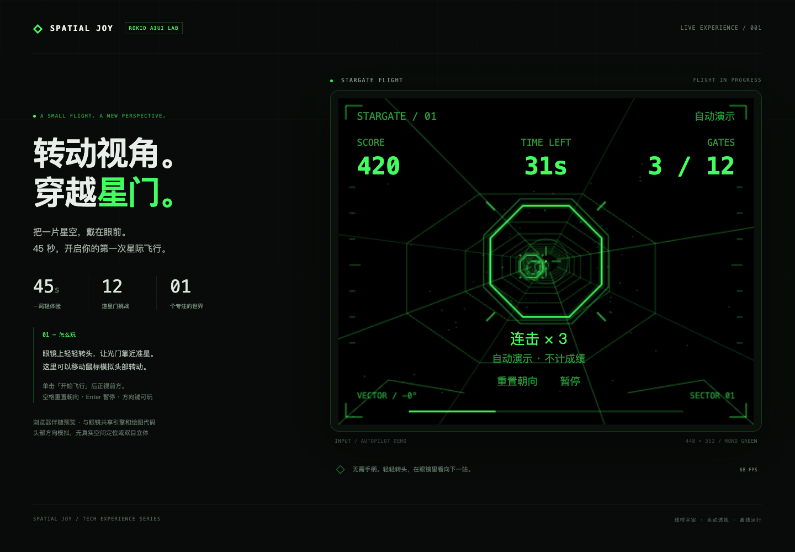

# 星门穿梭 · Stargate Flight

为2026年11月27—29日商场线下路演准备的Rokid AIUI短体验。**2秒校准 + 45秒飞行，单关12道星门**。原地轻轻转头，眼前的绿色线框隧道、远近星点与光门会改变透视；穿门触发连击和粒子反馈，最后5秒进入跃迁收尾。



## 直接使用

- **眼镜安装包：** `dist/stargate-flight.aix`，要求 Ink `^0.19.1`。
- **AIUI Studio源码导入：** `dist/stargate-flight-source.zip`，解压后根目录是 `app.json`、`app.js`、`pages/` 与 `lib/`。
- **源码开发目录：** `app/`。
- **官方Reader：** `verification/aiui-reader.html`。需通过HTTP打开，首次加载官方Ink运行时需联网。

安装前按目标设备支持的Craft/AIUI Studio/AIX流程导入。此环境未连接Rokid，也没有可用adb，因此没有执行眼镜安装或宣称真机通过。官方开发入口：https://github.com/yodaos-project/AIUI 。

## 游戏操作

首页左右摇头选择横排菜单，完整点头回正确认；保留点击、方向键和Enter。可选「开始飞行」「观赏演示」「设置」「按键模式」。第四个按钮选中时整排菜单在约180ms内向左平移，回到第三个时向右恢复；首尾选择循环。菜单平移由应用控制，不依赖宿主scroll-view动画。

开始后保持正视前方约2秒建立中立朝向。飞行时用小幅左右转头与轻抬低头引导航向，看向下一道光门。靠近准星意味着朝向更接近光门。每穿过一门获得100分，加上每次20分的连击奖励（连击加成最多200分），漏门不中断；10门以上为王牌领航员，6门以上为星际探索者，其余为初航完成。

- 点击「重置朝向」可把当前头朝向设为正前方；按键模式用空格回正。
- 点击「暂停」或按Enter暂停；继续时重新校准，不计暂停时间。
- 方向键模式每次小幅改变偏航/俯仰；空格归零。观察模式自动穿门，明确显示「自动演示 · 不计成绩」。演示转手动会重新开局。
- 设置可分别反转左右/上下方向和关闭音效，均只保存在当前会话。
- 返回/双击退出由宿主处理，不拦截Backspace。隐藏时本局取消，再进入回到首页。

## 本机预览和构建

Node.js 20+、Python 3；AIX CLI固定0.10.1。

```bash
npm ci
npm test
npm run check
npm run build
npm run preview
```

打开 http://127.0.0.1:4327/preview/ 。鼠标模拟头部方向，方向键可切换按键控制。浏览器预览与眼镜共享游戏引擎、三维投影、Canvas绘图和菜单控制器；网页的鼠标/音频适配器独立，不冒充真实传感器。预览服务只绑定本机127.0.0.1。

重新生成官方Reader：

```bash
npx aix preview dist/stargate-flight.aix --html-out verification/aiui-reader.html
```

## 结构和实现

- `app/lib/flight.js`：三维点投影、45秒状态、12门路径、命中与计分；`renderer.js`只绘图。
- `app/lib/pose.js`：绝对姿态四元数相对校准；未提供或同步启动失败时尝试陀螺仪。陀螺仪短时积分会漂移，可主动重新校准。缺失/错误/2秒无初始读数或1秒断流则显式暂停，允许重试或切换按键。
- `app/lib/controller.js`：权威运行状态与墙钟子步进，负责暂停、继续、按键和自动演示；`pages/index/index.ink`负责原生生命周期、菜单和Canvas适配。
- `preview/`：共享引擎的浏览器伴随展示。
- `marketing/`：应用简介、路由意图、实际生成的Logo/海报和小红书文案，未自动发布。

菜单复用本机aiui-production的`imu.js`与aiui-production-standard公共`MenuController`，游戏与菜单只允许一个传感器所有者。无记录列表、语音、相机、模型和导出，因此不套用业务记录模板。WXML使用`ink:`指令，无不支持的CSS动画。

## 证据与边界

见 `verification/REPORT.md` 和 `docs/DEVICE-ACCEPTANCE.md`。本地测试23项通过，静态检查和真实AIX打包通过；官方Ink 0.19.1 Reader渲染通过。具体浏览器与Reader验收结果记录在报告，不以合成输入外推真机效果。

这是**单画面的三维透视投影**：提供随头部方向变化的纵深感，不提供双目视差、6DoF、真实场景锚定或身体位移追踪。AIUI是运行平台，本游戏不调用AI模型；成绩由公开规则计算。

**隐私：** 游戏离线，无登录、无网络请求、无相机或麦克风权限。仅当前会话内存持有成绩与设置，回首页清除成绩，退出清除设置。`app.json.permissions`为空。官方网页Reader依赖外部运行时下载，与眼镜游戏本体离线能力分开。
