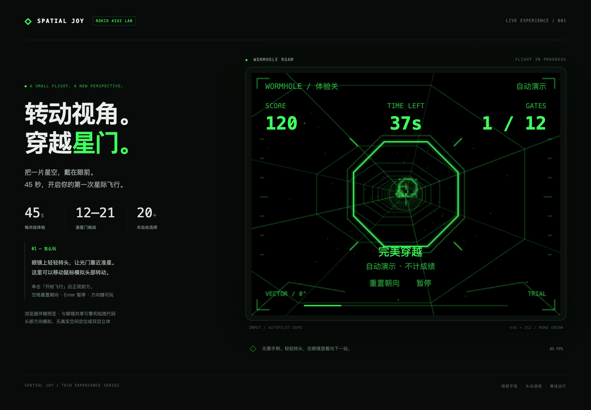

# 虫洞漫游 · Wormhole Roam

为2026年11月27—29日商场线下路演准备的Rokid AIUI短体验。**原体验关 + 20个进阶关卡，每关2秒校准 + 45秒飞行、12至21道星门**。原地轻轻转头，眼前的绿色线框隧道、远近星点与光门会改变透视；穿门触发连击和粒子反馈，最后5秒进入跃迁收尾。



## 直接使用

- **眼镜安装包：** `dist/wormhole-roam.aix`，要求 Ink `^0.19.1`。
- **AIUI Studio源码导入：** `dist/wormhole-roam-source.zip`，解压后根目录是 `app.json`、`app.js`、`pages/` 与 `lib/`。
- **源码开发目录：** `app/`。
- **官方Reader：** `verification/aiui-reader.html`。需通过HTTP打开，首次加载官方Ink运行时需联网。

安装前按目标设备支持的Craft/AIUI Studio/AIX流程导入。此环境未连接Rokid，也没有可用adb，因此没有执行眼镜安装或宣称真机通过。官方开发入口：https://github.com/yodaos-project/AIUI 。

## 游戏操作

首页左右摇头选择横排菜单，完整点头回正确认；保留点击、方向键和Enter。可选「开始飞行」「观赏演示」「自由选关」「设置」「按键模式」。自由选关无需解锁，结果页可主动下一关、重玩或重新选关；第20关结束不自动循环。第四个按钮选中时整排菜单在约180ms内向左平移，回到第三个时向右恢复；首尾选择循环。菜单平移由应用控制，不依赖宿主scroll-view动画。

开始后保持正视前方约2秒建立中立朝向。飞行时用小幅左右转头与轻抬低头引导航向，看向下一道光门。靠近准星意味着朝向更接近光门。每穿过一门获得100分，加上每次20分的连击奖励（连击加成最多200分），漏门不中断；命中率达到5/6为王牌领航员，至少命中一半为星际探索者，其余为初航完成。

- 点击「重置朝向」可把当前头朝向设为正前方；按键模式用空格回正。
- 点击「暂停」或按Enter暂停；继续时重新校准，不计暂停时间。
- 方向键模式每次小幅改变偏航/俯仰；空格归零。观察模式自动穿门，明确显示「自动演示 · 不计成绩」。演示转手动会重新开局。
- 设置可分别反转左右/上下方向和关闭音效，均只保存在当前会话。
- 返回/双击退出由宿主处理，不拦截Backspace。隐藏时本局取消，再进入回到首页。

## 本机预览和构建

Node.js 20+、Python 3；AIX CLI固定0.10.1。

```bash
npm ci
npm test
npm run check
npm run build
npm run preview
```

打开 http://127.0.0.1:4327/preview/ 。鼠标模拟头部方向，方向键可切换按键控制。浏览器预览与眼镜共享游戏引擎、三维投影、Canvas绘图和菜单控制器；网页的鼠标/音频适配器独立，不冒充真实传感器。预览服务只绑定本机127.0.0.1。

重新生成官方Reader：

```bash
npx aix preview dist/wormhole-roam.aix --html-out verification/aiui-reader.html
```

## 结构和实现

- `app/lib/flight.js`：三维点投影、45秒状态、按等级生成的光门路径、命中与计分；`renderer.js`只绘图。
- `app/lib/pose.js`：绝对姿态四元数相对校准；未提供或同步启动失败时尝试陀螺仪。陀螺仪短时积分会漂移，可主动重新校准。缺失/错误/2秒无初始读数或1秒断流则显式暂停，允许重试或切换按键。
- `app/lib/controller.js`：权威运行状态与墙钟子步进，负责暂停、继续、按键和自动演示；`pages/index/index.ink`负责原生生命周期、菜单和Canvas适配。
- `preview/`：共享引擎的浏览器伴随展示。
- `marketing/`：应用简介、路由意图、实际生成的Logo/海报和小红书文案，未自动发布。

菜单复用本机aiui-production的`imu.js`与aiui-production-standard公共`MenuController`，游戏与菜单只允许一个传感器所有者。无记录列表、语音识别、相机、模型和导出（含启航TTS），因此不套用业务记录模板。WXML使用`ink:`指令，无不支持的CSS动画。

## 证据与边界

见 `verification/REPORT.md` 和 `docs/DEVICE-ACCEPTANCE.md`。本地测试46项通过，静态检查和真实AIX打包通过；官方Ink 0.19.1 Reader渲染通过。具体浏览器与Reader验收结果记录在报告，不以合成输入外推真机效果。

这是**单画面的三维透视投影**：提供随头部方向变化的纵深感，不提供双目视差、6DoF、真实场景锚定或身体位移追踪。AIUI是运行平台，本游戏不调用AI模型；成绩由公开规则计算。

**隐私：** 游戏离线，无登录、无网络请求、无相机或麦克风权限。仅当前会话内存持有成绩与设置，回首页清除成绩，退出清除设置。`app.json.permissions`为空。官方网页Reader依赖外部运行时下载，与眼镜游戏本体离线能力分开。

## 1.1.0：20关进阶与生成器

1.1.0曾采用每5关3%的小幅缩圈；当前1.2.0已强化为圈径从100%逐关缩到30%，位移和速度同步增加。见 [关卡参数表](docs/LEVELS.md)。`app/lib/levels.js`已提供带种子的确定性生成器，但本次尚未开放自定义参数编辑器或无限关卡入口。当前关卡选择仅在本次会话内存保留。

部分宿主的轻触事件不提供具体按钮编号，此时轻触确认当前高亮项；有按钮编号的点击则直接选择对应按钮。

## 1.2.0：强化难度与修正左右

新增第1—20关圈径从100%连续缩到30%，最大相邻位移2.2→3.8，速度9→15.3（100%→170%）。45秒时长不变，世界门距保持27，速度提高后到达间隔变短，门数12→21，HUD与评级按实际数量计算。原体验关仍为12门。

头动和鼠标模拟的默认左右符号由+1改为−1；「反转左右」切到+1，「恢复左右」回到−1。菜单IMU、方向键与上下轴不变。方向是否符合目标Rokid实际佩戴仍需真机确认。

## 1.2.1：名称统一

作品正式名称为「虫洞漫游 / Wormhole Roam」，应用、预览、调用意图、安装包、海报与参赛策划案同步更新。历史验证截图及日志保留当时名称，当前画面见 `verification/rename-*.png`。玩法和难度参数保持1.2.0不变。

参赛PDF：`output/pdf/虫洞漫游_作品策划案_Spatial_Joy_2026.pdf`。

开始前飞船提示弹窗：每句以 > 开头，逐字显示，尝试TTS朗读；仅有「开启旅程」确认按钮，确认后才校准、飞行。文字提醒静坐与轻微转头，禁止驾车或行走时游玩；不适暂停。

## 1.3.0：飞船启航提示

开始、重玩、下一关均先进入提示弹窗，返回键可退出。提示等待期间没有飞行计时与游戏传感器；隐藏时清理逐字显示定时器，丢弃迟到回调。关闭音效时也不播TTS；TTS调用失败明确回退文字。AIUI未提供可靠的播报结束/取消API，不以估时判断播报结束，不依赖语音完成自动启航；宿主已经接收的播报可能持续到该短句结束。浏览器语音独立适配，效果不代替Rokid真机验收。

## 1.3.1：虫洞回声背景音乐

原创4小节芯片宇宙主题：体验关及1–5关80 BPM，6–10关92 BPM，11–15关104 BPM，16–20关116 BPM。音高不变；四个11025Hz单声道8-bit PCM WAV共440529字节（约430KiB），编辑用旋律MIDI另附。生成脚本为scripts/create-space-music.py。飞行时低音量播放，暂停/结束/隐藏停止，沿用音效开关。浏览器使用原生音频循环，AIUI Sound无loop及结束事件，按PCM时长定时重播，可能存在宿主调度带来的小接缝，需Rokid试听验收。
